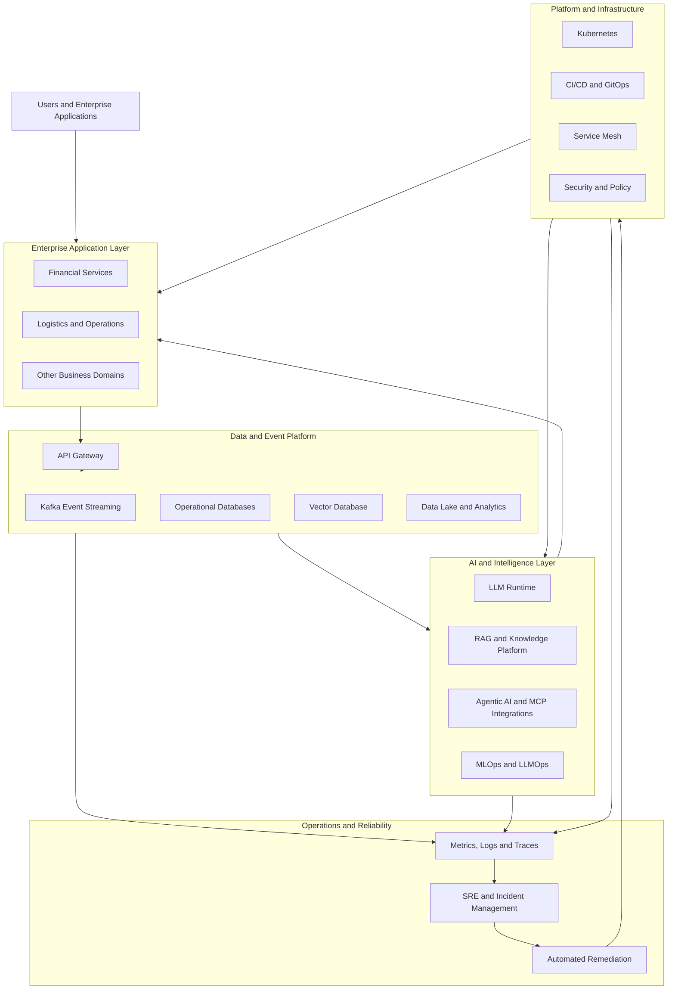

# Enterprise AI Platform Engineering

### Building the Next Generation of Intelligent, Cloud-Native Enterprise Systems

An enterprise-scale platform engineering initiative bringing together Artificial Intelligence, Agentic AI, Retrieval-Augmented Generation (RAG), Model Context Protocol (MCP), MLOps, LLMOps, DevSecOps, cloud-native infrastructure, event-driven microservices, data engineering, cybersecurity, and Site Reliability Engineering.

The vision is to design an integrated enterprise ecosystem where AI applications, intelligent agents, data pipelines, microservices, and infrastructure can be developed, deployed, secured, observed, and operated through standardized platform capabilities.

> **Project vision:** One unified engineering ecosystem for building, deploying, scaling, securing, and operating intelligent enterprise applications.

---

## Table of Contents

- [Overview](#overview)
- [Vision and Objectives](#vision-and-objectives)
- [Architecture Domains](#architecture-domains)
- [Enterprise Application Domains](#enterprise-application-domains)
- [AI and Agentic AI Platform](#ai-and-agentic-ai-platform)
- [Data and Event-Driven Architecture](#data-and-event-driven-architecture)
- [Platform Engineering and DevOps](#platform-engineering-and-devops)
- [Cloud-Native Infrastructure](#cloud-native-infrastructure)
- [MLOps and LLMOps](#mlops-and-llmops)
- [Security and Governance](#security-and-governance)
- [Observability and SRE](#observability-and-sre)
- [Technology Ecosystem](#technology-ecosystem)
- [Repository Structure](#repository-structure)
- [Implementation Roadmap](#implementation-roadmap)
- [Getting Started](#getting-started)
- [Engineering Principles](#engineering-principles)
- [Project Status](#project-status)
- [Contributing](#contributing)
- [License](#license)

---

## Overview

Modern enterprises increasingly require more than isolated applications, independent AI models, and traditional CI/CD pipelines. They need a unified engineering foundation that connects application development, data processing, AI inference, automation, security, infrastructure, and operational reliability.

This project explores the architecture and engineering practices needed to build such an ecosystem.

The platform is organized around reusable infrastructure, shared capabilities, independently deployable services, AI workloads, data services, and operational tooling.

### Core capabilities

- **AI Engineering:** LLM-powered applications, intelligent decision systems, AI assistants, and agentic workflows.
- **RAG and Knowledge Engineering:** Document ingestion, embeddings, vector search, semantic retrieval, and context-aware generation.
- **MCP and Tool Integration:** A planned integration layer for connecting compatible AI clients and agents to controlled tools and contextual resources.
- **MLOps and LLMOps:** Model lifecycle management, experiment tracking, training pipelines, evaluation, deployment, and monitoring.
- **Platform Engineering:** Reusable developer templates, golden paths, deployment standards, service discovery, and self-service capabilities.
- **DevOps and DevSecOps:** Automated build, test, security scanning, artifact management, deployment, and GitOps workflows.
- **Cloud-Native Engineering:** Kubernetes, microservices, infrastructure as code, service mesh, autoscaling, and resilient deployments.
- **Data Engineering:** Streaming pipelines, relational and document databases, caching, vector storage, and data governance.
- **Enterprise Security:** Identity, secrets management, policy enforcement, encryption, audit trails, and AI-specific security controls.
- **Observability and SRE:** Metrics, logs, traces, alerting, incident management, resilience testing, and automated remediation.

The repository is designed as a long-term engineering program. Its directory structure represents the intended scope; individual capabilities may be at different stages of implementation.

---

## Vision and Objectives

### Vision

Create a reusable enterprise engineering ecosystem that supports the entire lifecycle of modern software and AI systems—from development and data ingestion to deployment, inference, observability, and continuous improvement.

### Objectives

1. Establish consistent engineering standards across applications and infrastructure.
2. Enable reusable CI/CD and GitOps deployment patterns.
3. Integrate AI and machine learning into enterprise workflows responsibly.
4. Build event-driven systems for real-time and asynchronous processing.
5. Provide repeatable environments for development, testing, staging, and production.
6. Apply security and governance throughout the software and AI lifecycle.
7. Standardize observability, operational readiness, and reliability practices.
8. Explore self-healing infrastructure and AI-assisted incident response.
9. Support multiple business domains through reusable platform capabilities.
10. Document architecture decisions, operational procedures, and implementation progress.

---

## Architecture Domains

The platform is organized into interconnected engineering domains.

| Domain | Responsibility |
|---|---|
| Enterprise applications | Business workflows and domain services |
| AI platform | LLMs, agents, RAG, inference, and AI integrations |
| Data platform | Databases, streaming, storage, and data governance |
| Platform engineering | Developer experience, templates, and shared capabilities |
| Infrastructure | Kubernetes, networking, storage, and infrastructure as code |
| MLOps and LLMOps | Model and LLM lifecycle automation |
| Security | Identity, secrets, policy, compliance, and AI security |
| Observability | Metrics, logs, traces, dashboards, and alerting |
| SRE | Reliability, incident response, resilience, and recovery |

### High-level architecture



This diagram represents the intended logical architecture, not a claim that every integration is already deployed.

---

## Enterprise Application Domains

The repository includes architectural areas for multiple enterprise industries.

### Financial services and FinTech

- Customer onboarding and customer 360
- Know Your Customer (KYC)
- Anti-Money Laundering (AML)
- Sanctions screening and compliance
- Fraud detection and investigation
- Risk assessment and scoring
- Order management and trade lifecycle
- Market data ingestion and pricing
- Settlement and reconciliation
- Treasury and liquidity management
- Portfolio and wealth management
- Loan processing and underwriting
- AI-assisted reporting and decision support

### Additional enterprise domains

- Cybersecurity and threat intelligence
- E-commerce and customer experience
- Energy and smart-grid operations
- Healthcare and intelligent workflows
- Logistics and transportation
- Real estate analytics
- Smart-city services
- Telecommunications
- Airline operations
- Travel and tourism

These domains provide opportunities to reuse common platform services while keeping business logic separated into appropriate bounded contexts.

---

## AI and Agentic AI Platform

The AI domain is intended to support traditional machine learning, generative AI, retrieval-based applications, and autonomous or semi-autonomous agent workflows.

### Large Language Models

Planned areas include:

- Model runtime and inference serving
- Local model experimentation
- Model routing and lifecycle management
- Prompt templates and versioning
- Streaming responses
- Conversation memory
- Evaluation and feedback
- Model access controls and guardrails

Potential runtime technologies include Ollama, vLLM, and NVIDIA Triton, depending on the workload and deployment environment.

### Retrieval-Augmented Generation (RAG)

The RAG architecture is intended to support:

1. Document and knowledge ingestion
2. Parsing and preprocessing
3. Chunking and metadata enrichment
4. Embedding generation
5. Vector indexing
6. Semantic and hybrid retrieval
7. Context construction
8. LLM-based response generation
9. Citation and retrieval-quality evaluation
10. Access control and document-level security

Qdrant is included in the proposed vector-storage architecture. Other storage and retrieval components can be evaluated as implementation requirements evolve.

### Agentic AI

The agent platform is organized around capabilities such as:

- Agent registry and configuration
- Planning and workflow orchestration
- Tool selection and execution
- State and memory management
- Multi-agent coordination
- Human approval for sensitive actions
- Audit trails and execution history
- Evaluation and failure handling

Potential agent use cases include fraud investigation assistance, compliance research, customer support, financial analysis, incident triage, and operational remediation.

### Model Context Protocol (MCP)

MCP is an intended integration pattern for connecting compatible AI applications and agents to tools and contextual resources through controlled interfaces.

The planned MCP-related architecture may include:

- MCP client and server integrations
- Tool discovery and invocation
- Context and resource access
- Authentication and authorization
- Input validation and output handling
- Audit logging and execution policies
- Human approval for privileged actions

MCP integration should follow least-privilege principles. Access to infrastructure, financial operations, sensitive records, or production systems must not be granted automatically to an AI agent.

### AI self-healing and operational intelligence

The platform also explores AI-assisted operations:

1. Collect metrics, logs, traces, and events.
2. Detect anomalies or service degradation.
3. Correlate related alerts and operational signals.
4. Investigate possible root causes.
5. Recommend or execute approved remediation.
6. Validate service recovery.
7. Record the incident and generate a postmortem.

Automated remediation should use explicit policies, bounded permissions, audit trails, and rollback mechanisms.

---

## Data and Event-Driven Architecture

The data platform is intended to support transactional applications, asynchronous communication, analytics, AI retrieval, and streaming workloads.

### Event streaming

Apache Kafka is the proposed event backbone for communicating business events and processing streaming data.

Representative event flows include:

- Market data ingestion and distribution
- Transaction and payment events
- Fraud detection signals
- Customer activity events
- Model inference requests
- Notification and audit events
- Operational alerts and remediation requests

A typical event flow is:

```text
Data Producer
     |
     v
Kafka Topic
     |
     +----> Stream Processor
     |
     +----> Fraud Detection Service
     |
     +----> Analytics Pipeline
     |
     +----> Downstream Consumers
```

Topic design, schema compatibility, consumer-group management, retry handling, and dead-letter queues should be defined for each implemented workflow.

### Data services

| Component | Intended role |
|---|---|
| PostgreSQL | Relational and transactional data |
| MongoDB | Document-oriented application data |
| Redis | Caching, sessions, and low-latency access |
| Apache Kafka | Event streaming and asynchronous integration |
| Qdrant | Vector search and retrieval |
| MinIO | Object and artifact storage |

### Data engineering capabilities

The planned data domain also includes:

- Data validation and quality checks
- Data lineage and cataloging
- Schema and metadata management
- Retention and backup policies
- Data lake and warehouse architecture
- Synthetic data generation
- Reproducible data pipelines

---

## Platform Engineering and DevOps

The platform engineering domain aims to standardize how teams build, test, package, deploy, and operate services.

### CI/CD

The intended delivery workflow includes:

1. Source control and code review
2. Automated testing and quality checks
3. Dependency and vulnerability scanning
4. Container image building
5. Artifact publishing
6. Infrastructure and configuration validation
7. GitOps-based deployment
8. Deployment verification
9. Monitoring and rollback

Potential tools include Jenkins, GitLab, GitHub Actions where applicable, Maven, Docker, Trivy, Helm, and Argo CD.

The exact pipeline implementation depends on the selected source-control and deployment environment.

### Developer platform

Planned capabilities include:

- Reusable service templates
- Golden-path deployment patterns
- Standardized container and Kubernetes configurations
- Service catalog and ownership metadata
- Environment provisioning
- Configuration and secret-management patterns
- Documentation and operational runbooks
- Developer onboarding

### GitOps

Argo CD is included in the intended GitOps architecture for reconciling Kubernetes workloads with version-controlled desired state.

The design supports environment separation, reviewable deployment changes, controlled promotion, drift detection, and recovery procedures.

---

## Cloud-Native Infrastructure

Kubernetes is the proposed workload orchestration foundation.

### Infrastructure capabilities

- Namespaces and environment isolation
- Deployments, Services, and ingress
- Resource requests, limits, and quotas
- Horizontal and event-driven autoscaling
- Persistent storage and backup patterns
- Role-based access control
- Network policies and workload security
- Service mesh and traffic management
- Infrastructure as code
- Disaster recovery and environment recovery

### Service mesh

Istio is included in the architecture for capabilities such as:

- Service-to-service traffic management
- Mutual TLS
- Routing and traffic policies
- Resilience controls
- Service-level telemetry
- Controlled rollout strategies

### Infrastructure as code

Terraform is intended to support repeatable infrastructure provisioning and configuration across supported environments.

Infrastructure modules should be versioned, validated, documented, and designed to avoid embedding credentials or sensitive configuration in source control.

---

## MLOps and LLMOps

The MLOps and LLMOps domains address the lifecycle of models and AI applications.

### MLOps

- Data preparation and validation
- Experiment tracking
- Model training and evaluation
- Model registry and versioning
- Reproducible pipelines
- Model serving
- Drift detection
- Model performance monitoring

Apache Airflow and MLflow are included in the proposed architecture for orchestration and experiment or model lifecycle management.

### LLMOps

- Prompt and configuration versioning
- Model and retrieval evaluation
- Latency and token-usage monitoring
- Response-quality assessment
- RAG evaluation
- Safety and guardrail testing
- Regression testing
- Model deployment and rollback

AI systems should be evaluated for quality, reliability, security, latency, and cost—not only whether a response was successfully generated.

---

## Security and Governance

Security is intended to be integrated throughout application development, infrastructure management, AI execution, and production operations.

### Security capabilities

- Identity and access management
- Least-privilege authorization
- Secret and certificate management
- Encryption in transit and at rest
- Container and dependency scanning
- Kubernetes security policies
- Network segmentation
- Audit logging
- Vulnerability management
- AI prompt and tool security
- Personally identifiable information protection
- Compliance evidence and retention policies

Potential technologies include HashiCorp Vault, Open Policy Agent (OPA), Kyverno, Trivy, and cert-manager.

### AI security principles

- Treat external documents and retrieved content as untrusted input.
- Validate tool arguments and enforce authorization outside the model.
- Prevent unrestricted execution of privileged operations.
- Protect secrets and sensitive information from prompts and logs.
- Require human approval for high-impact actions where appropriate.
- Record agent actions and preserve an auditable execution trail.
- Test for prompt injection, data leakage, and unsafe tool invocation.

Compliance and regulatory requirements must be validated against the relevant business domain and jurisdiction.

---

## Observability and SRE

Observability and reliability engineering are foundational to the intended platform.

### Observability stack

| Technology | Intended purpose |
|---|---|
| Prometheus | Metrics collection and alert evaluation |
| Grafana | Dashboards and operational visualization |
| Loki | Log aggregation |
| Tempo | Distributed tracing storage |
| OpenTelemetry | Instrumentation and telemetry collection |
| Alertmanager | Alert routing and grouping |

The architecture also includes service-level metrics, AI observability, incident correlation, and operational dashboards.

### SRE capabilities

- Service-level indicators (SLIs)
- Service-level objectives (SLOs)
- Error budgets
- Incident management
- Root-cause analysis
- Load and performance testing
- Chaos and resilience testing
- Capacity planning
- Backup and restore validation
- Disaster recovery
- Postmortems and continuous improvement

### Self-healing workflow

A future self-healing workflow may combine telemetry, alert correlation, anomaly detection, policy evaluation, and controlled remediation.

The objective is to reduce recovery time while preserving system safety, accountability, and operational control.

---

## Technology Ecosystem

The repository is designed to accommodate the following technology areas. Inclusion in this table indicates architectural scope or intended use, not necessarily a completed integration.

| Area | Technologies |
|---|---|
| Programming | Python, SQL, shell scripting |
| APIs and services | REST APIs, microservices, API gateways |
| Containers | Docker |
| Orchestration | Kubernetes |
| Infrastructure as code | Terraform |
| CI/CD | Jenkins, GitLab, GitHub Actions where applicable |
| GitOps | Argo CD |
| Build and security | Maven, Trivy |
| Service mesh | Istio |
| Event streaming | Apache Kafka |
| Databases | PostgreSQL, MongoDB, Redis |
| Object storage | MinIO |
| Vector search | Qdrant |
| AI and LLMs | Ollama, vLLM, model-serving runtimes |
| ML lifecycle | MLflow, Apache Airflow |
| Observability | Prometheus, Grafana, Loki, Tempo, OpenTelemetry |
| Policy and security | Vault, OPA, Kyverno, cert-manager |
| Testing and reliability | Unit, integration, load, resilience, and security testing |

The technology stack may evolve as components are implemented and validated.

---

## Repository Structure

The repository is organized into major engineering domains.

```text
Enterprise-AI-Platform-Engineering/
├── docs/                 # Architecture, diagrams, runbooks and standards
├── shared/               # Shared libraries and cross-cutting capabilities
├── infrastructure/
│   ├── kubernetes/       # Kubernetes workloads and platform components
│   ├── terraform/        # Infrastructure as code
│   └── argocd/           # GitOps applications and environment definitions
├── platform/             # Developer platform and shared services
├── services/             # Enterprise business and AI services
├── data-platform/        # Databases, streaming, vector and object storage
├── mlops/                # Model pipelines, evaluation and monitoring
├── ai/                   # LLM runtime, RAG, agentic AI and AI security
├── observability/        # Metrics, logs, traces and dashboards
├── security/             # Identity, secrets, policies and protection
├── sre/                  # Reliability, incident response and recovery
├── benchmarks/           # Benchmarking assets
├── performance-reports/  # Performance reports
├── api-contracts/        # API and integration contracts
├── sdk/                  # SDKs, CLI and internal tools
├── scripts/              # Operational automation
├── tests/                # Unit, integration and specialized tests
└── .github/workflows/    # Existing GitHub Actions workflow definitions, if used
```

Individual directories may contain architecture placeholders, implementation code, configuration, tests, or documentation. Refer to each component's documentation for its current maturity and setup requirements.

---

## Implementation Roadmap

The platform is intended to evolve incrementally rather than requiring every technology to be deployed at once.

### Phase 1 — Engineering foundation

- Establish repository standards and documentation.
- Define architecture boundaries and shared configuration.
- Build repeatable local development environments.
- Establish testing, linting, and code-quality practices.
- Document security and contribution requirements.

### Phase 2 — Cloud-native platform

- Deploy foundational Kubernetes services.
- Establish CI/CD and container build workflows.
- Introduce GitOps and environment separation.
- Implement service discovery, ingress, and configuration patterns.
- Integrate baseline metrics, logging, and tracing.

### Phase 3 — Data and event platform

- Deploy databases and caching.
- Establish Kafka topics and event contracts.
- Build representative producers and consumers.
- Implement data validation and persistence.
- Add vector and object storage where needed.

### Phase 4 — AI, RAG and agentic systems

- Deploy a selected LLM runtime.
- Build a document ingestion and RAG workflow.
- Implement controlled tool integrations and MCP where required.
- Introduce AI evaluation and guardrails.
- Develop a small number of demonstrable AI use cases.

### Phase 5 — MLOps and advanced operations

- Establish experiment tracking and model lifecycle workflows.
- Implement model and application monitoring.
- Develop event-driven scaling and controlled remediation.
- Add resilience testing and operational runbooks.
- Evaluate AI-assisted incident analysis.

### Phase 6 — Enterprise hardening

- Strengthen identity, authorization, and secret management.
- Validate backup and disaster recovery procedures.
- Establish measurable SLOs and error budgets.
- Test performance, failure scenarios, and security controls.
- Document architecture decisions and production-readiness gaps.

**Roadmap principle:** Prioritize a small number of fully working, tested, observable end-to-end workflows before expanding into additional services and domains.

---

## Getting Started

### Prerequisites

The tools required depend on which component you want to run.

Typical prerequisites include:

- Git
- Python and pip
- Docker Engine and Docker Compose
- Kubernetes and `kubectl` for cluster-based workloads
- Helm for chart-based deployments
- Terraform for infrastructure modules
- Access to any required model runtime or external service

Not every component is required for local development.

### Clone the repository

```bash
git clone <YOUR-REPOSITORY-URL>
cd Enterprise-AI-Platform-Engineering
```

Replace the placeholder with the actual clone URL for your GitHub or GitLab repository.

### Inspect the project

```bash
find . -maxdepth 2 -type f | sort
```

Review the architecture documentation, dependency files, environment examples, and component-specific README files before starting a workload.

### Configure the environment

If the relevant application supports the root Python environment:

```bash
python -m venv .venv
```

Activate the environment on Linux or macOS:

```bash
source .venv/bin/activate
```

Install dependencies only after confirming that the root dependency files and selected component are ready to run:

```bash
pip install -r requirements.txt
```

### Start a component

Select a documented service or local environment and follow its specific instructions. Docker Compose files are intended to support separate development, monitoring, and AI workloads where configured.

For Kubernetes deployments, inspect manifests and required secrets before applying them. Do not apply the entire infrastructure tree blindly.

> **Important:** The repository structure alone does not guarantee that all services can start successfully. Follow component-level instructions and validate prerequisites, configuration, secrets, and dependency availability before deployment.

---

## Engineering Principles

### Modularity

Keep business logic, infrastructure, data access, and AI capabilities separated behind clear interfaces.

### Automation

Automate repeatable build, test, security, deployment, and recovery tasks.

### Security by design

Apply least privilege, explicit authorization, secure defaults, and auditability from the beginning.

### Observability by default

Instrument services and workflows so that operational behavior can be understood and measured.

### Reproducibility

Version source code, infrastructure definitions, model configurations, dependencies, and deployment settings.

### Reliability

Use health checks, resource controls, timeouts, retries, failure isolation, and recovery testing where appropriate.

### Responsible AI

Evaluate AI outputs and tool execution, protect sensitive data, preserve human oversight for high-impact operations, and make failures visible.

### Incremental delivery

Prefer working, testable capabilities over an architecture that exists only as directory structure or documentation.

---

## Project Status

This repository represents a broad enterprise architecture and engineering initiative spanning AI, platform engineering, DevOps, data systems, security, and reliability.

**Current maturity should be evaluated component by component.** Some areas may contain working implementations, while others may represent planned architecture, templates, or future development.

Before treating a component as production-ready, validate its implementation, automated tests, security controls, deployment procedure, observability, and recovery behavior.

The long-term objective is to evolve the repository into a collection of integrated, demonstrable, and maintainable enterprise platform capabilities.

---

## Contributing

Contributions should follow the repository's engineering and security standards.

1. Review `CONTRIBUTING.md` before making changes.
2. Keep changes focused and document architectural decisions.
3. Add tests for new or modified behavior.
4. Never commit credentials, private keys, tokens, or real customer data.
5. Update relevant documentation and configuration examples.
6. Validate changes locally before submitting them.
7. Document limitations and incomplete integrations explicitly.

For security concerns, follow the process documented in `SECURITY.md`.

---

## License

See the [`LICENSE`](LICENSE) file for the applicable license terms.

---

## Final Note

Enterprise AI Platform Engineering is an evolving effort to connect software engineering, cloud-native platforms, AI systems, data infrastructure, and operational reliability into one coherent architecture.

The goal is not simply to use more technologies. It is to demonstrate how those technologies can work together through secure interfaces, automated delivery, measurable reliability, and practical enterprise use cases.

**Build the platform. Integrate the intelligence. Automate the operations. Engineer for reliability.**
